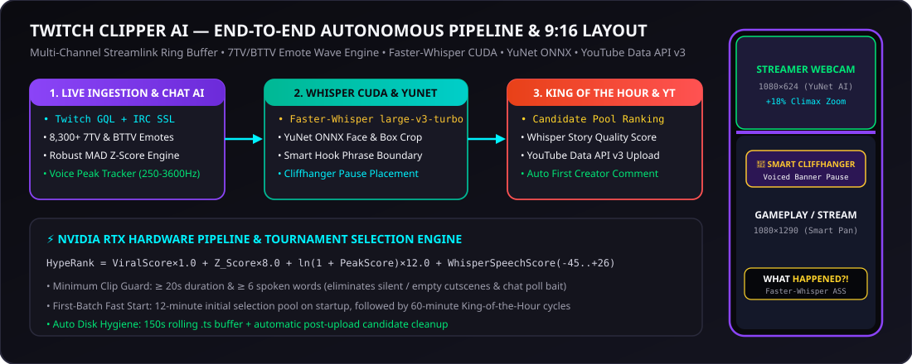
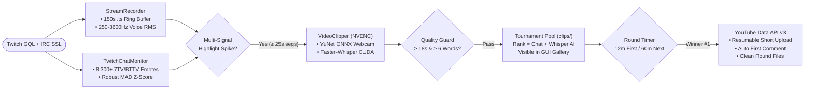

<div align="center">

# 🎬 Twitch Clipper AI

**Autonomous Multi-Channel Twitch-to-YouTube Shorts / TikTok (9:16) Highlight Engine with Faster-Whisper CUDA Subtitles, YuNet ONNX Webcam Tracking, 7TV/BTTV Emote Wave Detection & Official YouTube Data API v3 Tournament Uploader**

[](https://github.com/arsqwertyy/twitch-clipper-ai/actions/workflows/ci.yml)
[](https://www.python.org/)
[](video_clipper.py)
[](subtitle_burner.py)
[](face_detector.py)
[](youtube_uploader.py)
[](LICENSE)

**[🇬🇧 English](README.md)** · **[🇷🇺 Русский](README.ru.md)**

</div>

---

## 📖 Overview

**Twitch Clipper AI** is a full-stack autonomous highlight detection, vertical video rendering, and publishing pipeline built for high-retention **YouTube Shorts** and **TikTok (`1080×1920`, 9:16)**. It monitors **10+ live Twitch streams simultaneously** with near-zero CPU overhead, fuses real-time **Twitch IRC + 7TV/BetterTTV emote waves** with **streamer voice dynamics**, renders hardware-accelerated split-screen vertical shorts on **NVIDIA RTX (`h264_nvenc`)**, burns dynamic **Faster-Whisper (`large-v3-turbo`)** karaoke subtitles, and runs an automated **"King of the Hour" (`👑 Король часа`)** tournament that publishes only the highest-ranked highlight to YouTube Shorts via the official **YouTube Data API v3**.

<div align="center">
  
</div>

---

## ✨ Key Engineering Features

- **📡 Multi-Channel Zero-Transcode Ingestion (`Streamlink` + `FFmpeg`):**
  - Ultra-fast `0.35s` online status probing via **Twitch GQL** (spawns `streamlink` subprocesses only for channels confirmed live).
  - Maintains a lightweight `150-second` rolling `.ts` ring buffer per live channel (`-c copy`) with automatic segment cleanup on stream exit.
- **🎭 7TV & BetterTTV Emote-Wave + Voice Fusion Engine:**
  - Automatically syncs and caches **8,300+ channel-specific and global 7TV / BTTV emotes** (`CAUGHT`, `AINTNOWAY`, `xdd`, `ICANT`, `HUH`, `OMEGALUL`, plus personal channel emotes).
  - Combines a non-blocking **Robust Median + MAD Z-Score** chat analyzer (excluding the active buildup window to prevent self-masking) with a `250–3600 Hz` bandpass **Voice Peak Tracker** and **7TV Emote-Wave Detector**.
  - Filters out low-value chat polls (`1`, `2`, `+`), bot messages, and ambient idle/dance emotes (`catJAM`, `Waiting`).
- **🧠 Pre-Stream VOD Auto-Calibration (`AutoTrainer`):**
  - Samples historical Twitch VOD chat windows via GraphQL to compute per-streamer baseline velocity, custom slang/emotes, and exact webcam coordinates before the broadcast starts.
- **📷 Neural Webcam Detection & Split-Screen 9:16 Compositor (`YuNet ONNX`):**
  - Scans high-resolution frame edges with **YuNet ONNX** + gradient border detection to lock onto the streamer's webcam box (`1080×624` top panel) while smart-panning the main gameplay feed (`1080×1290` bottom panel) away from the webcam corner.
  - Automatically switches to full-frame 9:16 rendering during full-screen IRL / Just Chatting scenes and applies a `+18%` **Climax Zoom-In** on the webcam at the peak audio timestamp.
- **📝 Faster-Whisper (`large-v3-turbo`) Karaoke Subtitles & Smart Hook Trimming:**
  - Runs GPU-accelerated speech recognition (`cuda`, `int8_float16`) to generate word-level `.ass` karaoke subtitles with spring pop-animation and dual-color emotional keyword highlights.
  - **Smart Hook & Cliffhanger Banner Pause:** Trims leading silence/broken phrases so every Short starts on a clean sentence boundary, and places an optional voiced chromakey banner freeze-frame on a clean phrase boundary `1–4 seconds` before the climax.
- **👑 "King of the Hour" Tournament & YouTube Data API v3 Publisher:**
  - Collects candidate clips in `clips/` (strictly enforcing `≥ 20s` duration and `≥ 6` spoken words), ranks them by a combined **Chat Explosion + Whisper Speech Quality Score** (penalizing chat-poll/giveaway bait and rewarding punchy quotes & story hooks), displays all active candidates in the GUI gallery (`👑 #1 Leader`, `🎯 #2 Candidate`...), publishes the `#1` winner to **YouTube Shorts** with an automated **Creator First Comment**, and cleans up the round's local files.

---

## ⚙️ System Architecture & Control Flow



---

## 📊 Candidate Ranking & Quality Scoring Matrix

| Signal Component | Formula / Condition | Weight / Impact | Purpose |
| :--- | :--- | :---: | :--- |
| **Chat Viral Index** | `Z-Score + Reaction Z + 7TV Ratio + Voice Z` | `0 .. +100 pts` | Measures relative intensity of the live reaction wave |
| **Chat Z-Score** | `(HypeScore - RobustMedian) / EffectiveSTD` | `× 8.0` | Normalizes explosion magnitude across small & massive streams |
| **Peak Crowd Scale** | `12.0 × ln(1 + PeakHypeScore)` | `+30 .. +75 pts` | Rewards high-volume cross-channel moments |
| **Whisper Rich Speech** | `16–95 words + Catchy Quote + Story Triggers` | `+10 .. +26 pts` | Prioritizes clips with clear dialogue, humor, and plot |
| **Chat-Poll / Sub Bait** | *"Type + in chat"*, *"Vote 1 or 2"*, *"Thanks for sub"* | **`-45.0 pts`** | Prevents giveaway/poll spikes from beating real highlights |
| **Silent / Empty Clip** | `< 18s` duration or `< 6` spoken words | **Hard Reject** | Eliminates silent cutscenes, AFK chairs, and broken segments |

---

## 📂 Project Structure

```text
twitch-clipper-ai/
├── .github/
│   └── workflows/
│       └── ci.yml                 # Automated GitHub Actions Python syntax & config CI
├── assets/
│   └── pipeline_overview.svg      # Vector architecture & 9:16 split-screen layout diagram
├── banners/
│   └── dinodrop-voiced-banner-1-8.mp4  # Chromakey voiced cliffhanger overlay asset
├── gui.py                         # CustomTkinter dark studio GUI (Dashboard, Gallery, Settings)
├── main.py                        # Headless CLI runner (--train, --test-clip, --youtube-login)
├── chat_monitor.py                # Async Twitch IRC client & multi-signal highlight detector
├── emote_manager.py               # 7TV API v3 & BetterTTV API v3 channel emote synchronizer
├── stream_recorder.py             # Streamlink + FFmpeg rolling .ts ring buffer & watchdog
├── video_clipper.py               # NVIDIA NVENC 9:16 compositor, climax zoom & banner engine
├── subtitle_burner.py             # Faster-Whisper CUDA speech-to-ASS karaoke subtitle generator
├── audio_analyzer.py              # Voice peak tracker, Smart Hook trimmer & cliffhanger locator
├── face_detector.py               # YuNet ONNX neural face & webcam border detector
├── webcam_editor.py               # Interactive drag-and-resize webcam crop editor dialog
├── trainer.py                     # Pre-stream Twitch VOD GraphQL chat & webcam auto-trainer
├── youtube_uploader.py            # Official YouTube Data API v3 OAuth client & tournament scorer
├── ffmpeg_utils.py                # CUDA/cuDNN DLL loader & NVENC hardware capability probe
├── yunet.onnx                     # OpenCV YuNet face detection ONNX model
├── config.yaml                    # Streamer profiles, detector thresholds & YouTube settings
├── requirements.txt               # Python package dependencies
├── run.bat                        # One-click Windows GUI launcher
├── run_cli.bat                    # One-click Windows CLI launcher
├── LICENSE                        # MIT License
├── README.md                      # English documentation
└── README.ru.md                   # Russian documentation (Документация на русском)
```

---

## 🚀 Getting Started

### 1. Prerequisites

- **OS:** Windows 10 / 11 (64-bit) or Linux
- **Python:** `3.11` or `3.12`
- **GPU (Recommended):** NVIDIA RTX / GTX GPU for `Faster-Whisper` (`cuda`, `int8_float16`) and `h264_nvenc` hardware encoding (automatically falls back to CPU `libx264` / `int8` if unavailable)

### 2. Installation

```bash
git clone https://github.com/arsqwertyy/twitch-clipper-ai.git
cd twitch-clipper-ai
python -m venv .venv
.venv\Scripts\activate
pip install -r requirements.txt
```

### 3. Launching the Studio GUI

```bash
python gui.py
```
*(Or double-click [`run.bat`](run.bat) on Windows).*

### 4. Headless CLI Mode

```bash
# Pre-train channel profiles and detect webcam coordinates from Twitch VODs
python main.py --train

# Start multi-channel live monitoring in the terminal
python main.py
```

---

## 📺 YouTube Data API v3 Setup (OAuth 2.0)

1. Open the [Google Cloud Console](https://console.cloud.google.com/), create a project, and enable **YouTube Data API v3**.
2. Configure the **OAuth consent screen** (`External`), add your Google account under **Test users**, and create an **OAuth Client ID** of type **Desktop app**.
3. Download the JSON file, open **Twitch Clipper AI → `⚙️ Настройки` (Settings)**, and click **`📂 Выбрать client_secrets.json`**.
4. Click **`🔑 Авторизовать YouTube (OAuth)`** and approve access in your browser.
   > **Security Note:** `client_secrets.json`, `youtube_token.json`, `.yt_api_channel.json`, and `youtube_uploads.json` are strictly excluded via [`.gitignore`](.gitignore) and never leave your machine.

---

## 📜 License

Distributed under the **MIT License**. See [`LICENSE`](LICENSE) for full details.
