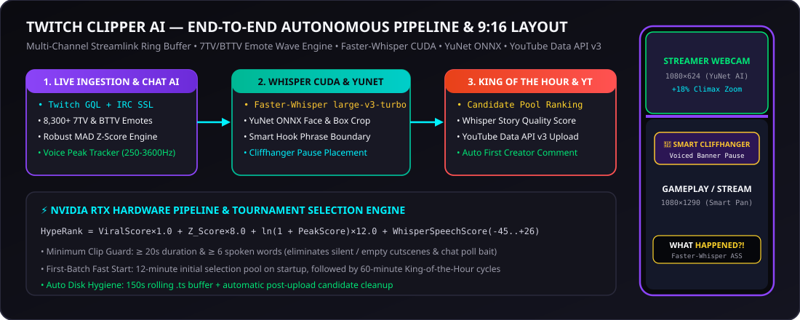

<div align="center">

# 🎬 Twitch Clipper AI

**Автономная ИИ-система нарезки лучших моментов со стримов Twitch в YouTube Shorts / TikTok (9:16) с субтитрами Faster-Whisper CUDA, поиском вебкамеры YuNet ONNX, поддержкой эмоутов 7TV/BTTV и турнирной авто-заливкой через YouTube Data API v3**

[](https://github.com/arsqwertyy/twitch-clipper-ai/actions/workflows/ci.yml)
[](https://www.python.org/)
[](video_clipper.py)
[](subtitle_burner.py)
[](face_detector.py)
[](youtube_uploader.py)
[](LICENSE)

**[🇬🇧 English](README.md)** · **[🇷🇺 Русский](README.ru.md)**

</div>

---

## 📖 О проекте

**Twitch Clipper AI** — это полностью автоматический конвейер поиска хайлайтов, вертикального видеомонтажа и публикации роликов в **YouTube Shorts** и **TikTok (`1080×1920`, 9:16)**. Программа одновременно отслеживает **10+ каналов Twitch** без нагрузки на процессор, объединяет взрывы чата **Twitch IRC + эмоуты 7TV / BetterTTV** с анализом громкости голоса стримера, рендерит вертикальные клипы на видеокарте **NVIDIA RTX (`h264_nvenc`)**, вшивает динамические караоке-субтитры **Faster-Whisper (`large-v3-turbo`)** и проводит турнирный отбор **«👑 Король часа»**, публикуя лучший клип в YouTube Shorts через официальный **YouTube Data API v3**.

<div align="center">
  
</div>

---

## ✨ Ключевые возможности

- **📡 Мульти-мониторинг эфиров без нагрузки на CPU (`Streamlink` + `FFmpeg`):**
  - Мгновенная проверка онлайна за `0.35 сек` через **Twitch GQL** (`streamlink` запускается только для реально активных эфиров).
  - Кольцевой буфер `.ts`-сегментов на `150 секунд` (`-c copy`) с автоматической очисткой диска при завершении стрима.
- **🎭 Детектор волн эмоутов 7TV / BetterTTV + пиков голоса стримера:**
  - Автоматическая синхронизация и кэширование **8 300+ эмоутов 7TV и BTTV** (`CAUGHT`, `AINTNOWAY`, `xdd`, `ICANT`, `HUH`, `OMEGALUL` и личные эмоуты каждого канала).
  - Робастный статистический детектор **Медиана + MAD Z-Score** в сочетании с голосовым детектором смеха и крика (`250–3600 Гц`).
  - Автоматическая фильтрация скучных опросов (`1`, `2`, `+`), ботов и фоновых танцевальных эмоутов (`catJAM`, `Waiting`).
- **🧠 Пред-стримовое ИИ-обучение по VOD (`AutoTrainer`):**
  - Анализирует записи прошлых стримов через Twitch GraphQL, подбирает индивидуальную норму чата и автоматически находит координаты вебкамеры стримера.
- **📷 Нейросетевой поиск вебкамеры и сплит-экран 9:16 (`YuNet ONNX`):**
  - Находит лицо и рамку вебкамеры стримера (`1080×624` сверху) и смещает игровой экран (`1080×1290` снизу) от угла с вебкой.
  - Автоматически переключается в полноэкранный режим 9:16 на IRL-стримах и делает зум `+18%` (`Climax Zoom-In`) на вебку в секунду главного пика звука.
- **📝 Караоке-субтитры Faster-Whisper (`large-v3-turbo`) и умная пауза под баннер:**
  - Генерирует пословные `.ass`-субтитры на GPU с поп-анимацией и двухцветным выделением эмоциональных слов.
  - **Smart Hook и интрига перед кульминацией:** обрезает пустую тишину в начале до первой целой фразы и ставит стоп-кадр с озвученным баннером строго на паузе между словами за `1–4 сек` до развязки.
- **👑 Турнирный отбор «Король часа» и авто-заливка в YouTube Shorts:**
  - Все нарезанные за раунд кандидаты (`≥ 20 сек`, `≥ 6 слов речи`) сохраняются в `clips/` и отображаются во вкладке **«🎬 Готовые клипы»** с их текущим местом (`👑 ЛИДЕР ОТБОРА №1`, `🎯 КАНДИДАТ №2` и т.д.).
  - ИИ оценивает смысл речи по расшифровке Whisper (штрафует байты на чат / переклички и награждает яркие цитаты и живую историю).
  - Первый раунд после запуска длится **12 минут** (чтобы не ждать час до первой публикации), последующие — раз в **60 минут**. Лучший клип №1 публикуется в YouTube Shorts с умным названием и **первым комментарием от автора**, после чего все кандидаты раунда удаляются с ПК.

---

## 🚀 Быстрый старт

```bash
git clone https://github.com/arsqwertyy/twitch-clipper-ai.git
cd twitch-clipper-ai
python -m venv .venv
.venv\Scripts\activate
pip install -r requirements.txt
python gui.py
```

---

## 📜 Лицензия

Проект распространяется под лицензией **MIT**. Подробности в файле [`LICENSE`](LICENSE).
